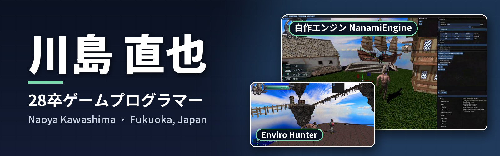
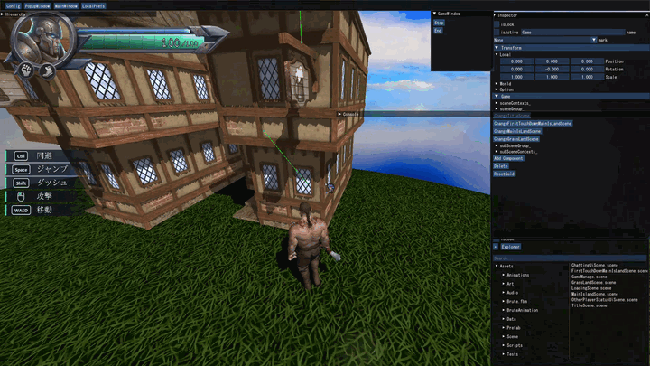
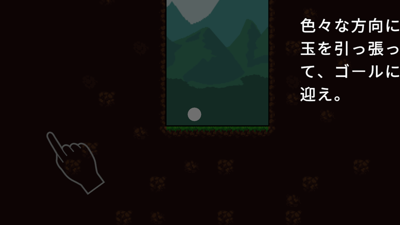
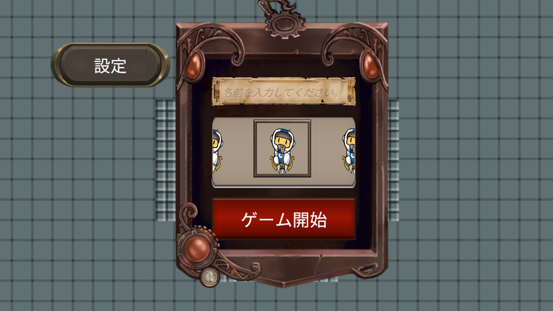

福岡でゲームプログラマーを目指している28卒の専門学校生です！ 
C++ / DxLib の自作3Dエンジン **NanamiEngine** で、運営型オンラインアクション **Enviro Hunter** を開発しています。

## 作っているもの
**[NanamiEngine](https://github.com/ramasuke/NanamiEngine-Public)**：C++ / DxLib / ImGui の自作3Dエンジンとエディタ。ホットリロード、BehaviourTree のグラフエディタ、オンライン対応など

- **[NanamiHub](https://github.com/ramasuke/NanamiHub)**：NanamiEngine のプロジェクトとエンジンのバージョンを管理するランチャー (C# / WPF)
- **[The Dungeon](https://github.com/ramasuke/The_Dungeon)**：C++ で作った 2D ダンジョンゲーム
- **ValuePack**：複数の値をまとめた型を作る C# Source Generator (.NET / Unity)。準備中です！

## 遊べる作品 (unityroom)

[Balls](https://unityroom.com/games/throwballs) / [Defeat Rogue](https://unityroom.com/games/online-defeat-rogue)

ここには個人で作ったものだけを載せています。ほかの作品は[ポートフォリオ](https://e29switch.wixsite.com/kawashimanaoya)にあります！

## 使っている技術
C++ / C# / DxLib / ImGui / Unity

## リンク
- X：[@kawashima_naoya](https://x.com/kawashima_naoya)
- Portfolio：https://e29switch.wixsite.com/kawashimanaoya
