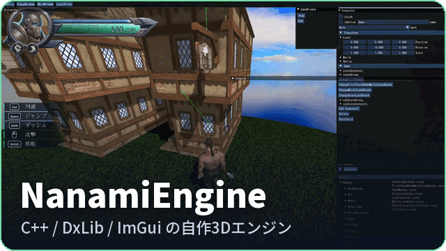
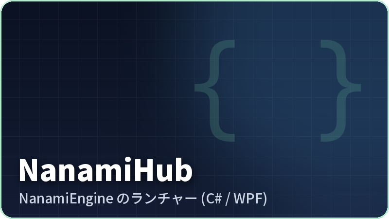
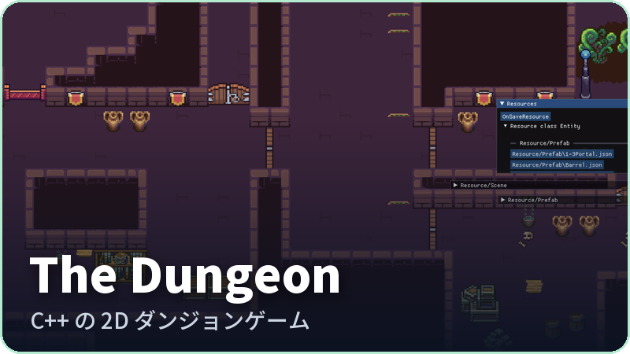
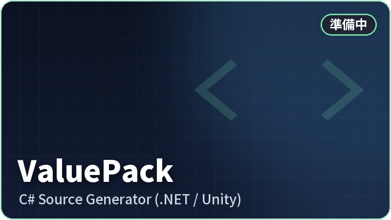
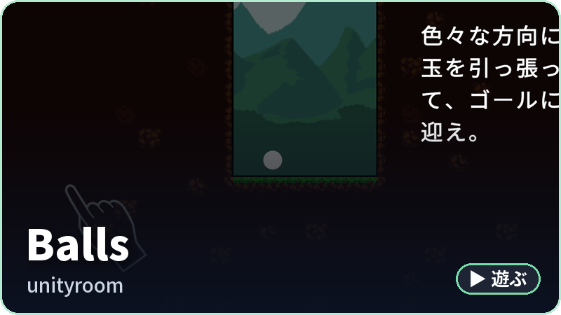
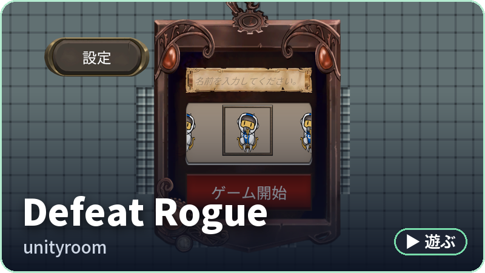

福岡でゲームプログラマーを目指している28卒の専門学校生です！ 
C++ / DxLib の自作3Dエンジン <b>NanamiEngine</b> で、運営型オンラインアクション <b>Enviro Hunter</b> を開発しています。

## 作っているもの

くわしく

- **NanamiEngine** — C++ / DxLib / ImGui の自作3Dエンジンとエディタ。ホットリロード、BehaviourTree のグラフエディタ、オンライン対応など
- **NanamiHub** — NanamiEngine のプロジェクトとエンジンのバージョンを管理するランチャー (C# / WPF)
- **The Dungeon** — C++ で作った 2D ダンジョンゲーム
- **ValuePack** — 複数の値をまとめた型を作る C# Source Generator (.NET / Unity)。準備中です！

## 遊べる作品 (unityroom)

ここには個人で作ったものだけを載せています。 
ほかの作品は <a href="https://e29switch.wixsite.com/kawashimanaoya"><b>ポートフォリオ</b></a> にあります！

## 使っている技術
`C++` `C#` `DxLib` `ImGui` `Unity`

## リンク
[X @kawashima_naoya](https://x.com/kawashima_naoya) ・ [Portfolio](https://e29switch.wixsite.com/kawashimanaoya)
